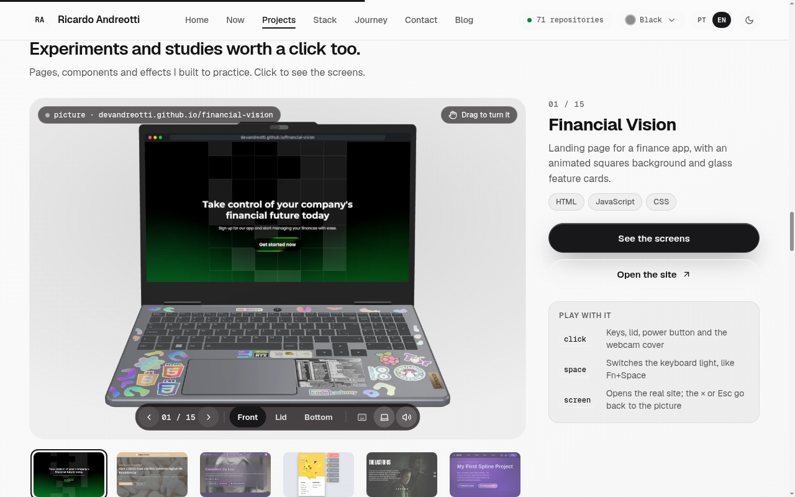
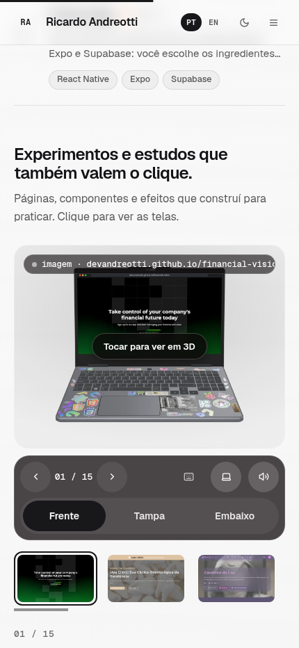
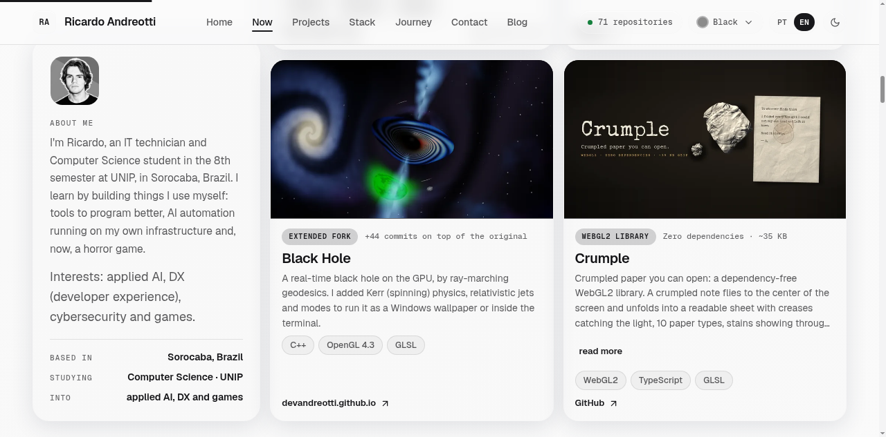
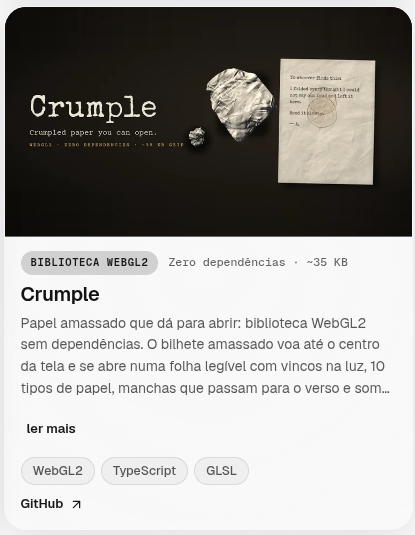
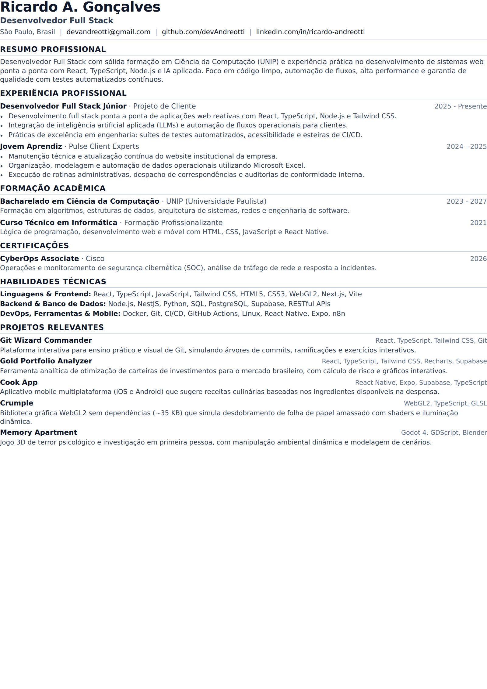
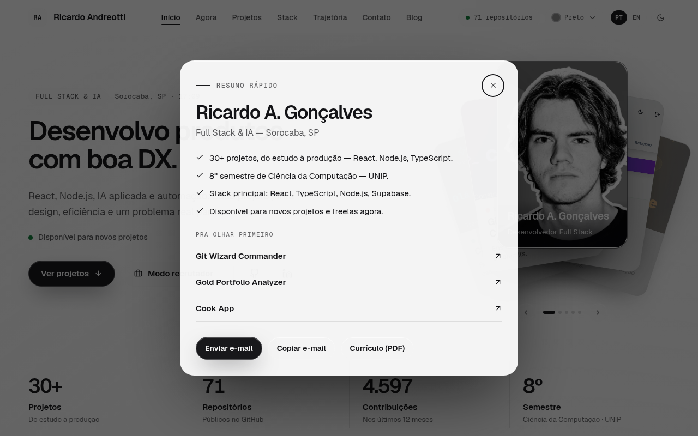
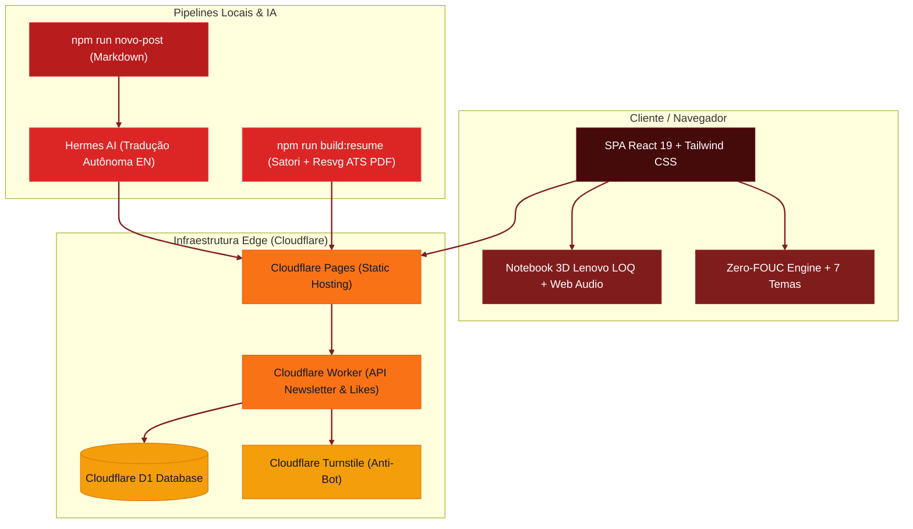

# ❄️ Frosted Motion Folio

<p align="center">
  
  
  
  
</p>

<p align="center">
  
  
  
  
  
  
  
  
</p>

<p align="left">
  <strong>Portfólio interativo de alta performance com Three.js, visual frosted glass e engenharia editorial full-stack.</strong><br />
  Uma experiência web moderna com renderização 3D sob demanda, geração automatizada de currículo ATS em PDF, blog bilíngue com tradução autônoma por IA e newsletter na Cloudflare Edge.
</p>


> "Um portfólio moderno não deve ser apenas uma vitrine estática de links, mas um laboratório vivo onde engenharia de software de ponta, design imersivo e automação contínua coexistem em produção."

---

## Visão geral

O **Frosted Motion Folio** é uma plataforma de portfólio e blog técnico desenvolvida com foco em alta fidelidade visual, performance extrema e automação ponta a ponta.

- **Notebook 3D Lenovo LOQ**: Modelo tridimensional interativo renderizado em Three.js, com iluminação dinâmica, animação da tampa, efeitos sonoros sintetizados em tempo real via Web Audio API (teclas mecânicas e som de boot) e arquitetura de performance `tap-to-3d` no mobile para evitar sobrecarga de GPU e assegurar 60 FPS consistentes.
- **Seção Agora com Memory Apartment TV & Crumple**: Painel dinâmico de status diário e projetos em andamento inspirado na filosofia `/now`, apresentando cards com microinteração tátil de dobra (efeito Crumple) e a retrô Memory Apartment TV para exploração visual de marcos da trajetória.
- **Modo Recrutador com Currículo ATS automatizado em PDF**: Cockpit de contratação rápida com visão resumida de senioridade e stack tecnológica, integrado ao pipeline `npm run build:resume` que compila automaticamente um currículo estruturado ATS em formato PDF (versões em português e inglês) via Satori e Resvg.
- **Blog bilíngue com tradução autônoma por IA e newsletter D1**: Publicação ágil via Markdown com GitOps (`npm run novo-post`), rotina autônoma de tradução para inglês orquestrada por agente de IA Hermes, contador de reações e sistema de newsletter com double opt-in, anti-bot Cloudflare Turnstile e persistência no Cloudflare D1.
- **7 Temas cromáticos com zero FOUC**: Sistema de customização visual com 7 paletas cromáticas distintas (Zinc, Rose, Blue, Green, Violet, Orange, Yellow) e alternância instantânea entre modo claro e escuro, protegido por script inline preventivo no `<head>` que elimina qualquer cintilação visual (Flash of Unstyled Content).

---

## Demo

### Home: Tema Claro vs Tema Escuro

| Tema Claro | Tema Escuro |
| :---: | :---: |
|  |  |

### Notebook 3D: Desktop vs Mobile (Tap-to-3D)

| Desktop (Renderização Automática & Áudio) | Mobile (Carregamento Sob Demanda Tap-to-3D) |
| :---: | :---: |
|  |  |

### Seção Agora & Interatividade Crumple

| Visão Geral da Seção Agora | Detalhe do Card com Efeito Crumple |
| :---: | :---: |
|  |  |

### Modo Recrutador & Currículo ATS em PDF

| Currículo ATS (Gerado via Build) | Modal do Recrutador (Cockpit Rápido) |
| :---: | :---: |
|  |  |

---

## Fluxo



---

## Para quem é

- **Desenvolvedores Frontend & Full-Stack** que buscam referências modernas de integração entre Three.js, React 19, shaders, som sintetizado com Web Audio e Tailwind CSS em alta taxa de quadros.
- **Recrutadores e Tech Leads** em busca de um perfil técnico transparente, com resumo executivo de competências, cockpit de habilidades e download direto de currículo calibrado para ATS.
- **Engenheiros de Software** interessados em arquiteturas estáticas com recursos dinâmicos de Edge (Cloudflare Workers, D1 SQL, Turnstile) sem complexidade de servidores dedicados.
- **Criadores Técnicos e Escritores** que priorizam um fluxo editorial GitOps fluido com tradução autônoma por IA e sistema de newsletter independente.

---

## Stack

- **React 19** para construção de interfaces reativas e declarativas com Vite.
- **TypeScript** para tipagem estática rigorosa e robustez na arquitetura do código.
- **Vite** para build tooling ultra-rápido com Hot Module Replacement (HMR).
- **Tailwind CSS** para estilização com classes utilitárias, design system frosted glass e tokens responsivos.
- **Three.js** para modelagem, materiais e renderização 3D interativa do notebook com suporte a WebGL.
- **Framer Motion** para animações declarativas, transições de páginas e gestos táteis.
- **Playwright & Axe-Core** para testes de regressão visual automatizados e auditorias de acessibilidade.
- **Cloudflare Workers & D1** para backend serverless edge, contagem de curtidas e gerenciamento de inscritos da newsletter.
- **Cloudflare Turnstile** para verificação anti-bot invisível em formulários.
- **Node.js, Satori & Resvg** para geração estática do currículo ATS padronizado em PDF e cards visuais dinâmicos.

---

## Pré-requisitos

*   [x] **Node.js 20+** - Ambiente de execução JavaScript/TypeScript moderno.
*   [x] **npm 10+** - Gerenciador de pacotes do projeto.
*   [x] **Git** - Controle de versão para fluxo de trabalho GitOps e Conventional Commits.
*   [x] **Wrangler CLI** *(opcional)* - Necessário para gerenciamento do banco D1 e deploy do Worker Cloudflare.

---

## Configuração

### 1. Clonar e instalar dependências

```bash
git clone https://github.com/devAndreotti/frosted-motion-folio-v2.git
cd frosted-motion-folio-v2
npm install
```

### 2. Variáveis de ambiente

Para executar a interface do portfólio em desenvolvimento local, nenhuma variável externa é obrigatória. Para testar o ecossistema completo de Worker, newsletter e validação anti-bot Cloudflare:

| Variável | Descrição | Exemplo |
|---|---|---|
| `VITE_TURNSTILE_SITE_KEY` | Chave pública do Cloudflare Turnstile | `0x4AAAAAA...` |
| `TURNSTILE_SECRET` | Chave secreta do Turnstile gravada no Worker | `0x4AAAAAA...` |
| `SMTP_USER` | Usuário SMTP para disparo de confirmação de e-mail | `newsletter@dominio.com` |
| `SMTP_PASS` | Senha ou token de autenticação SMTP | `super_secret_smtp_token` |
| `TOWER_ADMIN_TOKEN` | Token Bearer (mínimo 32 caracteres) para rotas administrativas do Worker | `a9f8b2c3d4e5f6...` |

Para provisionar os segredos no Worker da Cloudflare em produção:

```bash
bash scripts/newsletter/set-secrets.sh
```

### 3. Testar

```bash
npm test
```

---

## Uso

### Fluxo diário

1. Inicie o servidor local com `npm run dev`.
2. Escreva ou publique um novo artigo técnico usando `npm run novo-post`.
3. Regenere as versões em PDF do currículo ATS com `npm run build:resume`.
4. Valide a tipagem, testes unitários e cobertura com `npm test`.
5. Execute os testes de regressão visual com `npm run test:visual`.
6. Gere o pacote otimizado para produção com `npm run build`.

### Exemplo

```bash
# Iniciar servidor de desenvolvimento (http://localhost:5173)
npm run dev

# Criar um novo rascunho de post no blog (draft: true)
npm run novo-post -- "Engenharia de Performance com Web Workers e Three.js"

# Criar um post publicado diretamente (draft: false)
npm run novo-post -- "Arquitetura Edge com Cloudflare D1" --publicar

# Compilar versões em PDF do currículo ATS (PT e EN)
npm run build:resume

# Executar suíte de testes unitários com cobertura
npm test

# Executar testes de regressão visual Playwright
npm run test:visual

# Compilar build final de produção
npm run build
```

### O que fazer depois

- Testar o build de produção localmente com `npm run preview`.
- Registrar commits no padrão [Conventional Commits](https://www.conventionalcommits.org/).
- Enviar as alterações para o GitHub e acompanhar a pipeline no GitHub Actions.

---

## Estrutura do projeto

```text
frosted-motion-folio-v2/
├── docs/                 # Documentações de arquitetura, roadmaps e capturas de tela
├── public/               # Ativos estáticos, fontes, modelos 3D e manifestos
├── scripts/              # Utilitários de automação (currículo ATS, tradução IA, newsletter)
├── src/
│   ├── bones/            # Skeletons de carregamento com boneyard-js
│   ├── components/       # Componentes React (Notebook3D, NowSection, RecruiterModal, etc.)
│   ├── content/          # Posts do blog em Markdown e metadados
│   ├── contexts/         # Contextos globais (tema cromático, idioma)
│   ├── data/             # Dados estáticos de projetos, carreira e skills
│   ├── hooks/            # Hooks customizados para scroll, Web Audio e atalhos
│   ├── lib/              # Funções utilitárias, animações Framer Motion e i18n
│   ├── pages/            # Páginas da aplicação (Index, Blog, Uses, 404)
│   ├── styles/           # Folhas de estilo globais e tokens de cores
│   ├── App.tsx           # Componente raiz com roteador e provedores
│   └── main.tsx          # Ponto de entrada da aplicação React
├── tests/                # Testes de regressão visual e acessibilidade com Playwright
├── worker/               # API Edge em Cloudflare Worker com banco relacional D1
├── LICENSE               # Licença MIT
├── package.json          # Dependências e scripts do projeto
└── README.md             # Documentação principal do projeto
```

---

## Contribuindo

Contribuições são bem-vindas! Se você deseja colaborar com melhorias, novos recursos ou correções:

1. Faça um fork do repositório
2. Crie uma branch para sua modificação: `git checkout -b feature/sua-feature`
3. Commit suas alterações seguindo o padrão Conventional Commits: `git commit -m "feat: implementar suporte a nova animação"`
4. Envie sua branch para o repositório remoto: `git push origin feature/sua-feature`
5. Abra um Pull Request detalhando as alterações realizadas

Padrões de commit aceitos:
- `feat:` Nova funcionalidade
- `fix:` Correção de bug
- `docs:` Alterações na documentação
- `style:` Ajustes de formatação sem alteração de comportamento
- `refactor:` Refatoração de código
- `test:` Inclusão ou ajuste de testes
- `chore:` Tarefas de manutenção ou dependências

---

## Licença

Este projeto está sob a licença **MIT**. Veja o arquivo [LICENSE](./LICENSE) para detalhes.

---

<p align="center">
  Desenvolvido com ☕ por <a href="https://github.com/devAndreotti">devAndreotti</a>
</p>
