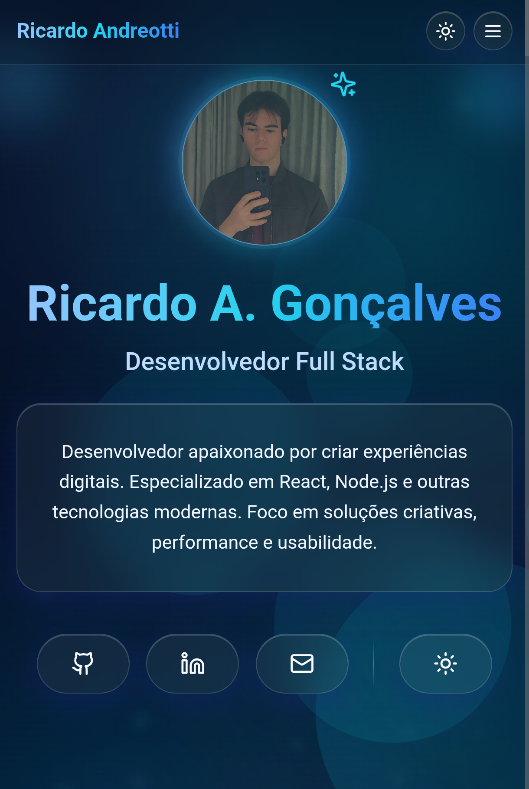
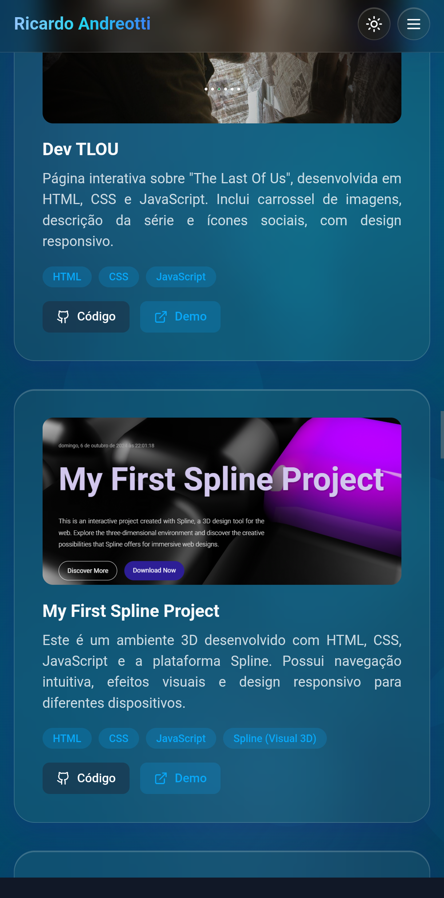
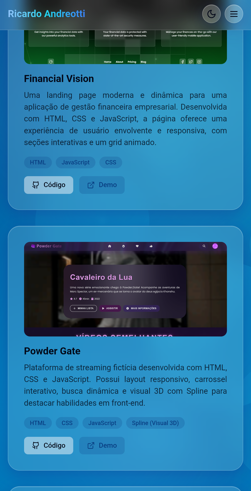

# ❄️ Frosted Motion Folio — Portfólio Interativo e Dinâmico!
<p align="center">
  
  
  
</p>

<p align="center">
  
</p>

## 📋 Sobre o Projeto
O **Frosted Motion Folio** é um portfólio pessoal moderno e interativo, desenvolvido para destacar projetos de forma fluida e responsiva.  
Com **efeito vidro fosco**, **animações suaves** e **tema claro/escuro**, o projeto oferece uma navegação elegante e intuitiva.  
Construído com **React**, **TypeScript**, **Tailwind CSS** e **Framer Motion**.

## ⚙️ Funcionalidades Principais
- 🎨 **Design Interativo**: Animações suaves e navegação fluida.
- 📂 **Seções Dedicadas**: Início, Sobre, Skills, Projetos e Contato.
- 🧩 **Apresentação de Projetos**: Cards com descrição, tecnologias e links.
- 📱 **Design Responsivo**: Compatível com todos os tamanhos de tela.
- ❄️ **Efeito Frosted Glass**: Visual elegante e moderno.
- 🌗 **Tema Claro/Escuro**: Alternância automática ou manual de tema.
- 🌐 **Bilíngue**: Abre em português ou inglês conforme o idioma do navegador, com troca manual PT | EN.

<p align="center">
  
</p>

<p align="center">
  
</p>

## 🌐 Acesse o Projeto
👉 [**devandreotti.com**](https://devandreotti.com): publicado na Cloudflare a cada merge na `main`.

Cópia espelho no [GitHub Pages](https://devandreotti.github.io/frosted-motion-folio-v2/).

## ✍️ Publicar um post
Cada post é um arquivo Markdown em [`src/content/posts/`](./src/content/posts). Publicar é fazer commit na `main`: o build gera a página, o RSS e o sitemap.

**Pelo navegador (sem instalar nada):** [**➕ criar um post novo no GitHub**](https://github.com/devAndreotti/frosted-motion-folio-v2/new/main?filename=src/content/posts/AAAA-MM-DD-meu-post.md&value=---%0Atitle%3A%20Meu%20post%0Adate%3A%20AAAA-MM-DD%0Adescription%3A%20Uma%20frase%20para%20o%20card%20e%20o%20buscador.%0Atags%3A%20%5Bblog%5D%0Adraft%3A%20false%0A---%0A%0AEscreva%20aqui.%0A). O arquivo já abre com o cabeçalho pronto: troque `AAAA-MM-DD` (no nome do arquivo e em `date`), escreva o texto e clique em *Commit changes*.

**Pelo terminal:**
```bash
npm run novo-post -- "Título do post"            # cria o rascunho (draft: true)
npm run novo-post -- "Título do post" --publicar # já publicado (draft: false)
git add -A && git commit -m "post: título" && git push
```

- **Modelo com todos os recursos** (títulos, listas, bash, tabela, imagem, citação): [código-fonte](./src/content/posts/2026-10-15-um-blog-publicado-com-git-push.md) e [como fica publicado](https://devandreotti.com/blog/um-blog-publicado-com-git-push/). Imagens: coloque em `public/blog/<slug>/` e use ``.
- O endereço do post é o nome do arquivo sem a data: `2026-10-15-meu-post.md` vira `/blog/meu-post/`.
- `draft: true` só aparece no `npm run dev`; o build não publica nada do rascunho.
- **Inglês automático:** não precisa traduzir. Um cron do Hermes cria `<post>.en.md` ao lado do original, valida (blocos de código, links, imagens e estrutura idênticos), abre um PR só com esse arquivo e faz o merge quando os checks passam (`scripts/traduzir-posts.mjs`). Quem usa o site em inglês vê a versão traduzida, com o aviso "Translated from Portuguese by AI". Para corrigir uma tradução, edite o `.en.md` (ela só é refeita se o texto original mudar depois).
- Curtidas: usam o banco D1 da Cloudflare (`wrangler.jsonc`, bloco `d1_databases`). Sem ele o botão fica escondido.

## 📬 Newsletter
Formulário no blog (`NewsletterForm`) e no fim de cada post. A inscrição tem confirmação por e-mail (double opt-in), descadastro em um clique e a lista fica no D1 (`worker/newsletter.js`, tabela `subscribers`). O e-mail de confirmação sai do próprio Worker, pelo SMTP da Oracle (`worker/smtp.js`); o formulário só aparece onde o Worker responde `/api/newsletter/status`.

Ligar em produção (uma vez):
```bash
bash scripts/newsletter/set-secrets.sh   # grava SMTP_USER, SMTP_PASS (e TURNSTILE_SECRET, se estiver no arquivo) no Worker
```
O anti-robô é o Cloudflare Turnstile (chave pública em `wrangler.jsonc`, segredo só no Worker). A política de privacidade está em `/privacidade/` (`src/pages/Privacy.tsx`) e precisa continuar batendo com o que `worker/newsletter.js` faz. Respostas à newsletter vão para o Gmail via `Reply-To`.
Prévia e envio pela Tower: `/api/admin/newsletter/preview` monta o e-mail nos dois idiomas sem enviar nada; `/api/admin/newsletter/send` manda uma cópia de teste (`test_to`, com `[TESTE]` no assunto) ou um lote de até 20 inscritos confirmados por chamada, e a Tower repete até `remaining` zerar. Cada envio grava na tabela `newsletter_sends` (migração `0003`) um registro por edição e por e-mail, com o hash SHA-256 do endereço e nunca o endereço. Ela é apagada junto com a inscrição, no descadastro, na exclusão pelo painel e na limpeza das inscrições não confirmadas. Um envio que ficou pela metade não é repetido. O deploy aplica as migrações D1 no `main` antes de publicar o Worker (passo `D1 migrations (main)` em `.github/workflows/cloudflare.yml`).
Rotas de administração (`worker/admin.js`): `/api/admin/newsletter/<stats|lookup|delete|resend|preview|send>` servem o painel privado Tower, que roda no VPS e chama o Worker com `Authorization: Bearer <TOWER_ADMIN_TOKEN>`. O segredo `TOWER_ADMIN_TOKEN` (no mínimo 32 caracteres) fica só no Worker, gravado por `set-secrets.sh` ou pelo painel da Cloudflare. Sem ele, ou com um valor curto demais, essas rotas respondem 404, como se não existissem. Nenhuma resposta traz tokens de confirmação ou de descadastro.
O visual do e-mail semanal está em `scripts/newsletter/template.mjs` (tema claro/escuro e as 7 cores do site, sorteadas por semana); veja as prévias com `node scripts/newsletter/preview.mjs <pasta>`.

## 🛠 Tecnologias Utilizadas
- **[React](https://react.dev/)** — Biblioteca JavaScript para interfaces declarativas.
- **[TypeScript](https://www.typescriptlang.org/)** — Tipagem estática para maior robustez.
- **[Vite](https://vitejs.dev/)** — Build tool ultrarrápida para projetos modernos.
- **[Tailwind CSS](https://tailwindcss.com/)** — Estilização com classes utilitárias.
- **[Framer Motion](https://www.framer.com/motion/)** — Animações fluídas e declarativas.
- **[React Router DOM](https://reactrouter.com/en/main/start/tutorial)** — Gerenciamento de rotas no SPA.
- **[Lucide React](https://lucide.dev/guide/packages/lucide-react)** — Ícones SVG modernos e personalizáveis.

## 📂 Estrutura do Projeto
```
src/
├── bones/               # Skeletons e layouts estruturais (boneyard-js)
├── components/          # Componentes interativos (Header, Radar, Projects, Terminal...)
├── contexts/            # Provedores de estado (LanguageContext, ThemeContext)
├── data/                # Dados estáticos (projetos, skills, dados pessoais)
├── hooks/               # Custom React hooks (scroll, GitHub API, navegação por teclado)
├── lib/                 # Utilitários, configurações de animação e i18n
├── pages/               # Páginas da aplicação (Index, NotFound)
├── App.tsx              # Componente raiz
└── main.tsx             # Entrypoint da aplicação React
```

## 🚀 Como Rodar Localmente
1. **Clone o repositório:**

   ```bash
   git clone https://github.com/devAndreotti/frosted-motion-folio-v2.git
````

2. **Acesse a pasta do projeto:**

   ```bash
   cd frosted-motion-folio-v2
   ```

3. **Instale as dependências:**
   ```bash
   npm install
   # ou yarn
   # ou bun
   ```

4. **Inicie o servidor de desenvolvimento:**
   ```bash
   npm run dev
   # ou yarn dev
   # ou bun dev
   ```
````

## 🔮 Melhorias Futuras
* [ ] Adicionar novos projetos
* [ ] Melhorar performance e fluidez das animações
* [ ] Implementar suporte a múltiplos idiomas

## 💪 Como Contribuir
1. Faça um fork do repositório
2. Crie uma branch: `git checkout -b feature/nova-feature`
3. Commit: `git commit -m "feat: nova feature"`
4. Push: `git push origin feature/nova-feature`
5. Abra um Pull Request 🎉

## 📝 Licença
Este projeto está sob a licença MIT.
Consulte o arquivo [LICENSE](https://github.com/devAndreotti/devAndreotti/blob/main/LICENSE) para mais detalhes.

<br>

---

<p align="center">
  Desenvolvido com ☕ por <a href="https://github.com/devAndreotti">Ricardo Andreotti Gonçalves</a> 🧑‍💻
</p>